# 功能演示

按角色串联的界面实录，覆盖 6 个服务的全部对外能力。

> **截图环境**：2026-11-17，线上部署实例（1512×900）。
> 演示账号为部署时创建的测试账号，不含任何真实用户数据。
> 所有图片位于 [`docs/screenshots/`](screenshots/)。

**阅读顺序建议**：卖家侧（翻译 → 发布 → 推荐）→ 买家侧（搜索 → 详情）→ 管理端（运营 → 审核）。

---

## 一、认证与入口

### 01 · 登录

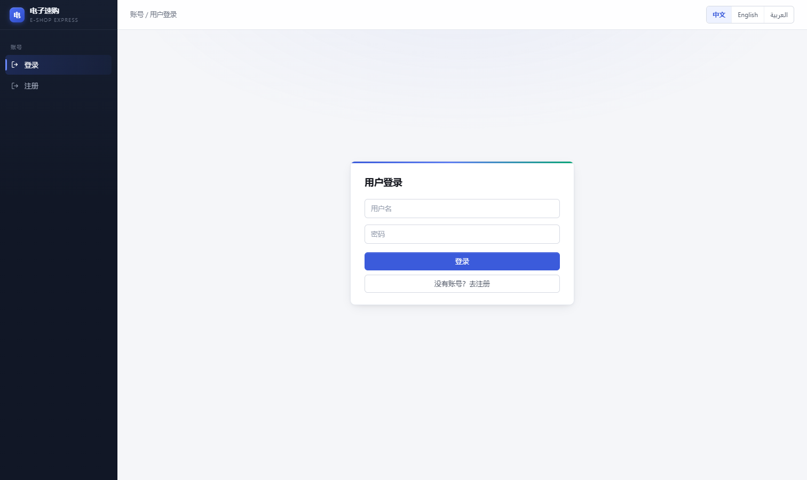

用户名或邮箱均可登录，登录后菜单按角色动态渲染。

- 密码存 **BCrypt** 哈希，校验在 `auth-service`
- 登录成功时把 `role_keys` / `permissions` 一并签进 JWT，**网关验签后向下游注入 `X-User-Id`，各服务不再回查权限表**
- 界面语言三档（中 / 英 / 阿），阿拉伯语自动切换 `dir="rtl"`

---

## 二、卖家工作台

### 02 · 智能翻译（工作台）

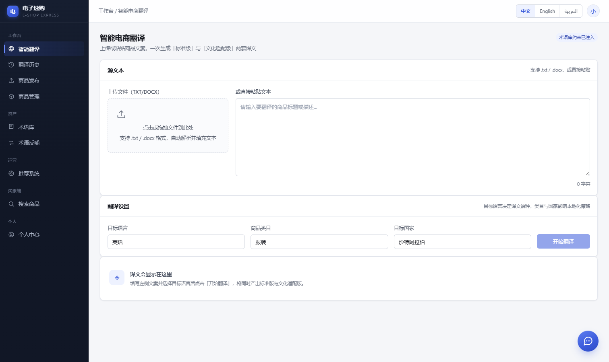

支持上传 `.txt` / `.docx` 或直接粘贴，一次生成「标准版 + 文化适配版」两版译文。

- 右上角「术语库约束已注入」是实时状态——翻译前会按当前用户 + 目标语种召回术语，拼成约束块塞进 prompt
- 目标语种决定术语过滤范围；品类与国家只作为 prompt 上下文
- 单次请求上限 5000 字

### 03 · 智能翻译（结果）

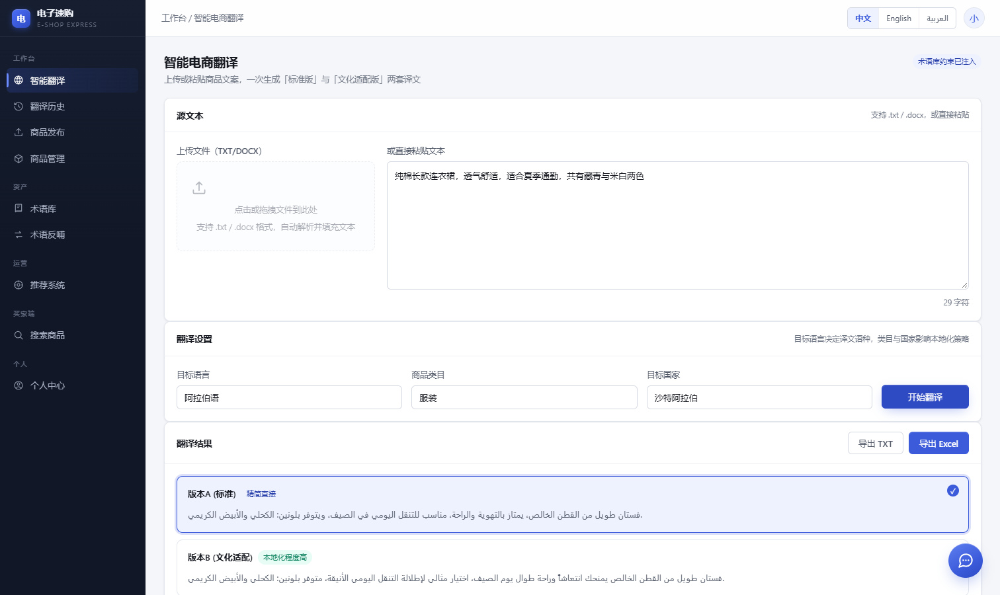

同一条中文文案产出两版阿拉伯语，并给出核心卖点与文化提示。

| 版本 | 定位 |
| :--- | :--- |
| 版本 A · 标准 | 忠实原文，术语与数值不动 |
| 版本 B · 文化适配 | 按目标市场改写表达，事实不变 |

- 阿拉伯语正确 RTL 渲染（`dir` 按语种切换，不是全局设置）
- 术语落地校验结果随响应返回（`checked` / `violations` / `compliance_rate`），**只上报不改写**——中→外方向没有可定位的替换目标，强行替换会破坏目标语言形态
- 可导出 TXT / Excel

### 04 · 翻译历史

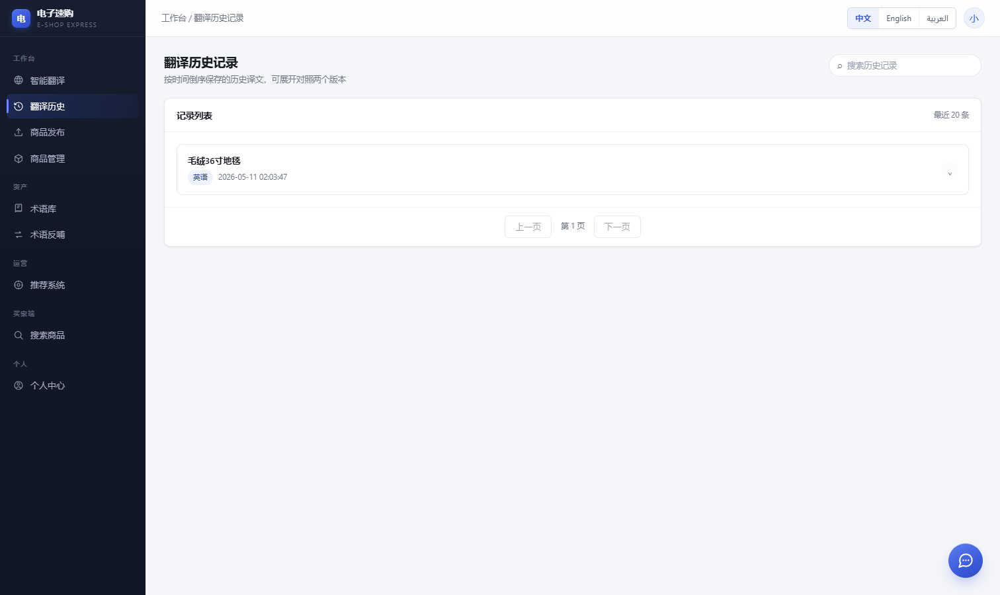

按用户隔离的历史记录，含语种、字符数与生成时间。

- 分页查询走 `translate_history`，`user_id` 索引
- 列表只返回 `version_a` / `version_b`（SEO 版用完即丢，见 README 已知限制）

### 05 · 商品发布

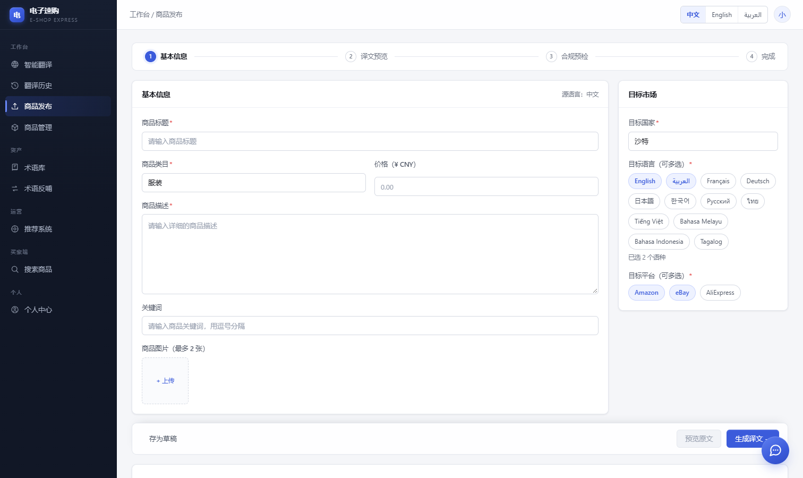

选定目标国家与语种后，系统批量生成各语种译文并做平台合规预检。

- 一次可勾选多个目标语种，逐个生成
- 合规预检按**平台禁用词 + 字符上限**判定，不是按国家法规
- 最终产出是**可发布草稿**，不调用任何平台开放 API

### 06 · 商品管理

商家自己的商品列表，可编辑多语种标题/描述、下架。

- 数据权限按 `product.user_id` 过滤，越权返回 404 而非 403（不泄露资源存在性）
- 编辑走 `PUT /api/merchant/products/{esin}`，`target_language` 决定写入哪一列

### 07 · 术语库

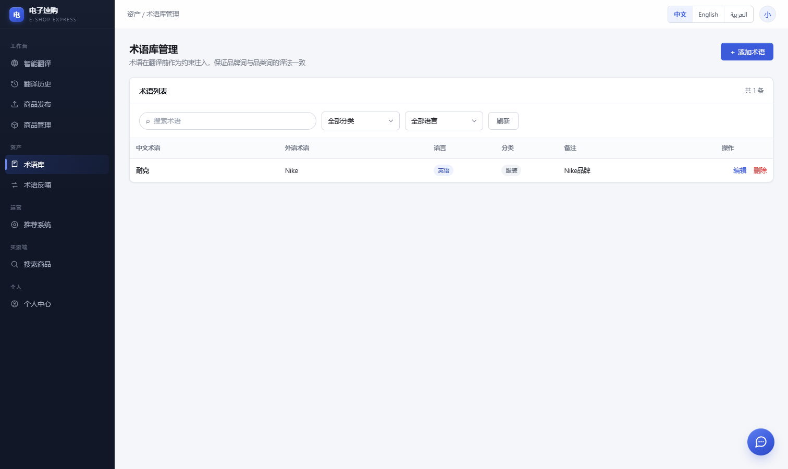

按语种维护「中文 → 目标语种」对照，支持品类与备注。

- 唯一键 `(user_id, chinese, language)`，同一术语可为不同语种设不同译法
- **私有数据隔离**：缓存键含 `user_id`，A 用户的术语不会命中给 B 用户
- 增删改后级联清理相关缓存

### 08 · 术语反哺

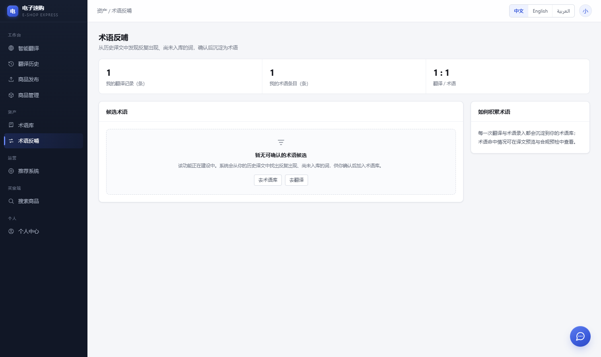

从已完成的翻译里反向提取候选术语，人工确认后入库。

- 这是术语库的**冷启动手段**——新用户没有术语积累时，先从历史译文里挖
- 候选按出现频次排序，避免逐条录入

---

## 三、推荐

### 09 · 智能推荐

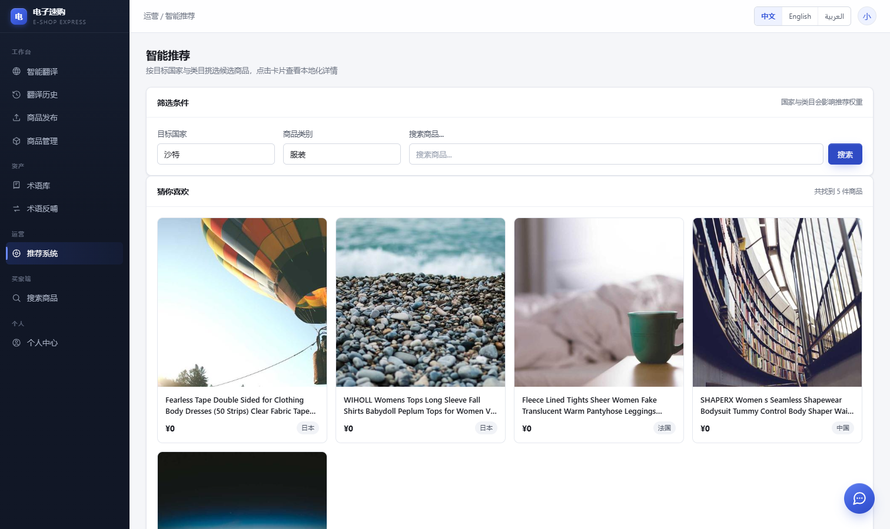

按目标国家 + 品类召回，LLM 做「主品 / 配件 / 无关」三分类后重排。

- 召回 = SBERT 语义相似度 + 关键词命中 + 国家匹配系数（同国 1.2 / 异国 0.7）
- 精排过滤掉配件类误配，实测占比 **29.6% → 12.5%**
- 结果缓存 30 分钟，键格式固定为 `recommend:{country}:{category}:{keyword}`

> **截图中价格显示 ¥0**：推荐接口只返回 `idx` / `id` / `name_en`，不含价格与图片，前端拿不到就渲染为 0。属于已知限制，见 README。

---

## 四、买家端

### 10 · 商品列表

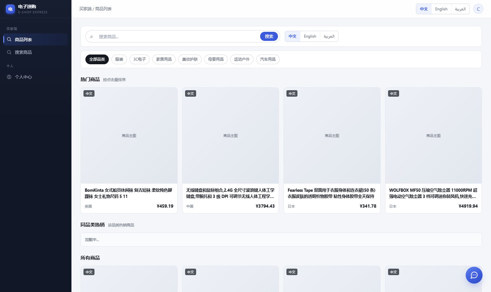

买家进入后的默认页，按热度推荐。

- 与搜索共用 `GET /api/products`，无关键词时走浏览分支
- `ES_USE_FOR_BROWSE=false`，浏览默认走 MySQL，避免 ES 排序开销

### 11 · 搜索结果

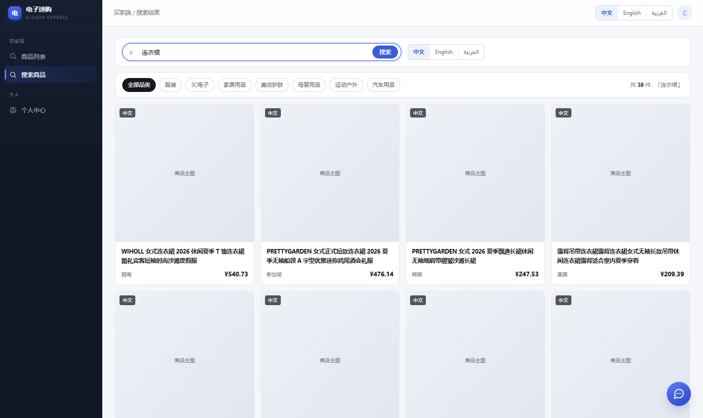

关键词「连衣裙」命中 38 件，支持品类筛选。

- 双路召回：ES（IK 分词）为主，不可用时**静默回落** MySQL ngram 全文索引，前端零改动
- 品类值是 `3C`（大写 C），ES 的 keyword 精确匹配对大小写敏感——前端统一用 `categoryRequestValue()` 归一化
- 价格按买家所在国家换算，`¥` 为 CNY 基准价

### 12 · 商品详情

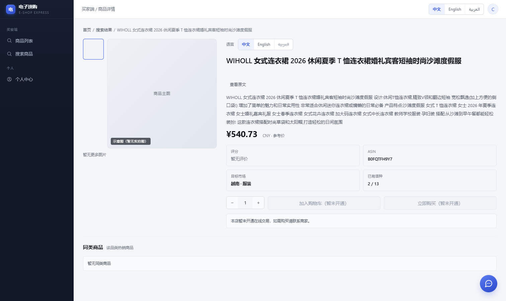

展示译文、ESIN、目标市场与语种进度。

- 响应含 **13 个语种的全部标题/描述字段**，前端按当前语言挑选
- 「已有语种 2/13」是真实进度：主表只写主目标语言，其余列填 ESIN 占位
- 交易相关按钮显式标注「暂未开通」——不假装有支付能力

### 13 · 空结果

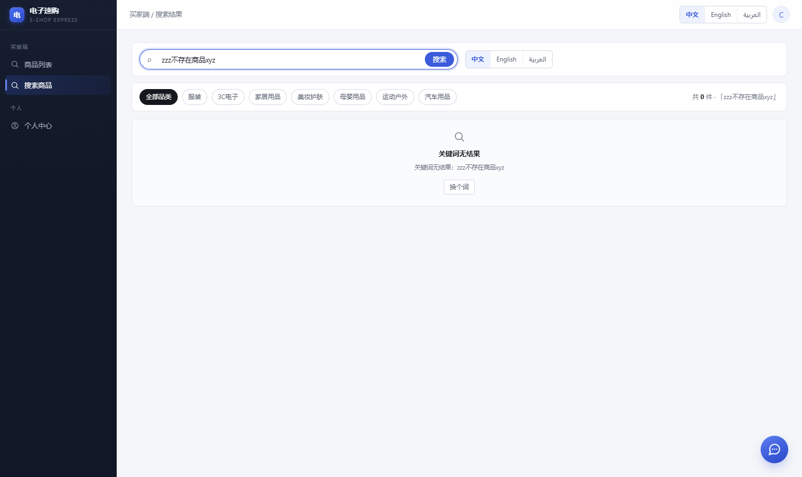

区分「这个词没有」还是「这个品类没有」，给出不同的下一步动作。

- 空态由二次查询判定：先查该品类下是否有商品，再查去掉关键词后是否有结果
- 三种成因对应三套文案与按钮，避免用户只看到一句"暂无商品"

---

## 五、搜索（卖家视角）

### 14 · 搜索商品

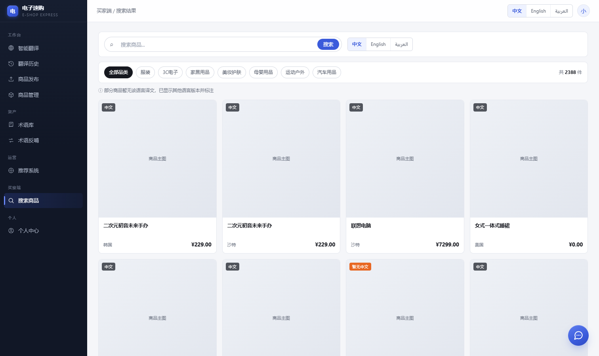

卖家可搜索全站商品做选品参考。

- 同一套检索链路，权限不同：买家只看已上架，卖家可看到自己的下架商品

---

## 六、个人中心

### 15 · 个人中心

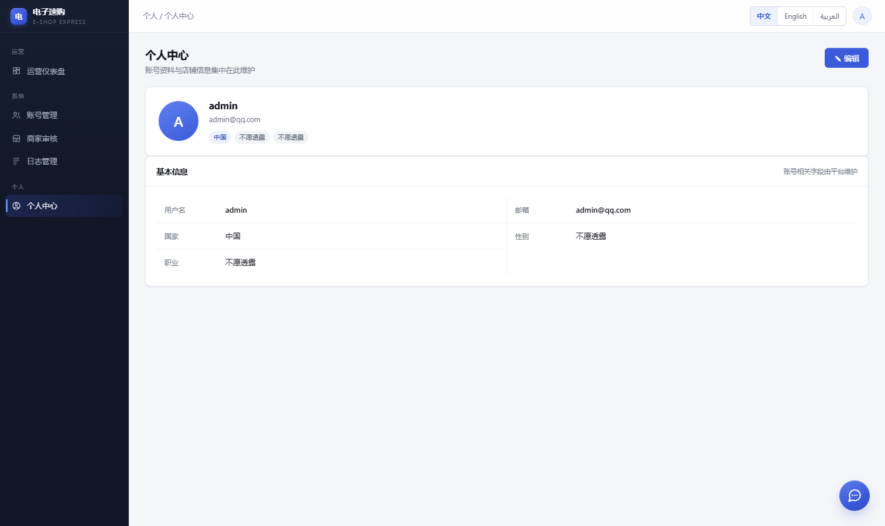

账号资料与店铺信息维护。

- 头像上传落 `UPLOAD_DIR`，网关统一提供 `/uploads/**`
- 客户 / 商家 / 管理员共用同一页面，按角色显示不同区块

---

## 七、管理端

### 16 · 账号管理

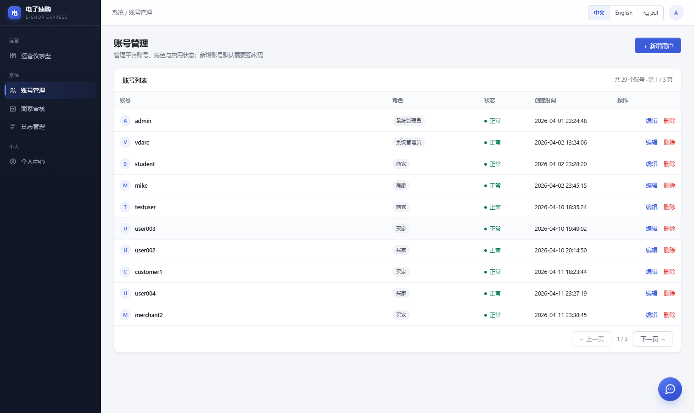

查看全部账号，可增删改与分配角色。

- 需 `admin` 角色，网关在 `AdminController` 路径上做二级判定
- 删除为软删除（`status=0`），保留操作日志关联

### 17 · 运营仪表盘

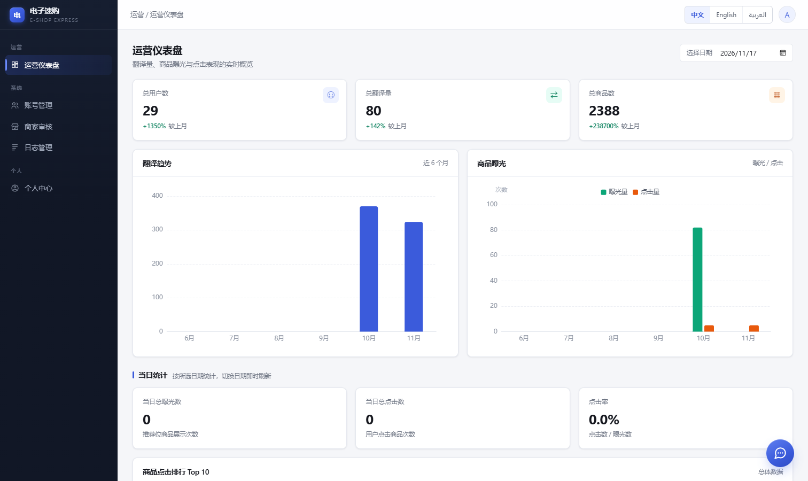

用户数、翻译量、商品数、曝光/点击趋势。

- 数据来自 `sys_users` / `translate_daily_report` / `product` / `biz_rec_stat_log` 的聚合
- 图表数据由后端直接返回，前端只做渲染
- 顶部可切日期，趋势按天聚合

### 18 · 商家审核

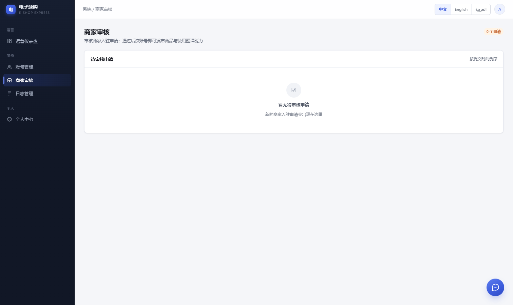

商家入驻申请列表，通过 / 驳回。

- 状态机 `pending → approved / rejected`
- 审核动作写 `sys_oper_log`，含操作人与耗时

### 19 · 日志管理

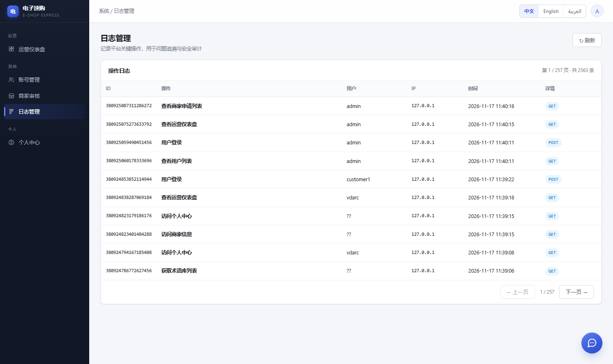

所有写操作的操作审计。

- 由 `OperationAuditInterceptor` 统一拦截，方法级注解标记要记录的动作
- 记录动作、参数、IP、耗时、异常信息
- 图片等大字段脱敏后才入库

---

## 附：功能与接口对照

| 界面 | 主要接口 | 服务 |
| :--- | :--- | :--- |
| 登录 | `POST /api/login` | auth |
| 翻译 | `POST /api/translate` | translation |
| 翻译历史 | `GET /api/translate/history` | translation |
| 术语库 | `GET/POST /api/glossary/*` | platform |
| 商品发布 | `POST /api/product/publish` | platform |
| 商品列表 / 搜索 | `GET /api/products` | catalog |
| 商品详情 | `GET /api/product/{esin}` | catalog |
| 推荐 | `POST /api/recommend` | recommendation |
| 仪表盘 | `GET /api/dashboard` | platform |
| 账号管理 | `GET /api/user/list` | platform |
| 商家审核 | `GET /api/merchant/applications` | platform |
| 日志 | `GET /api/log/list` | platform |
